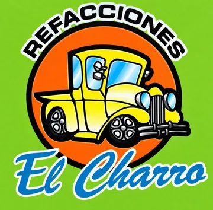
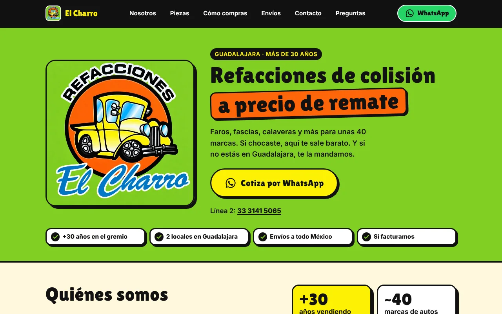

<div align="center">



# Refacciones El Charro

Sitio web de un negocio familiar de refacciones de colisión en Guadalajara, Jalisco, con más de 30 años de operación.

[**Ver el sitio en vivo →**](https://eito-tv.github.io/refacciones-el-charro/)


</div>

<p align="center">
  
  &nbsp;
  
</p>

## Sobre el proyecto

El negocio vendía solo en mostrador. Este sitio es el primer paso para llevarlo a internet: presenta quiénes son, qué venden, cómo trabajan y cómo comprar desde cualquier parte de México, y lleva al cliente a cotizar por WhatsApp con la información completa desde el primer mensaje.

## Características

- **Página de cotización (`/cotizar/`):** marca y modelo de listas (o escritos si no aparecen), año y una o varias piezas elegidas en mosaicos. Según la pieza pregunta solo lo que aplica: lado para faros y calaveras, delantera o trasera para fascias y defensas, ambas para puertas. Marca cada paso completo, muestra el mensaje antes de enviarlo, guarda el avance en el navegador del cliente y abre WhatsApp con todo listo.
- **Navegación:** menú tipo panel en celular y enlaces con indicador de sección en escritorio; barra inferior para cotizar que aparece al bajar.
- **Atribución sin herramientas:** todos los botones mandan un mensaje que identifica que el cliente llegó por la página.
- **SEO local:** datos estructurados `AutoPartsStore` y `FAQPage` (schema.org), Open Graph para compartir en redes, sitemap y página 404 propia.
- **Accesibilidad:** HTML semántico, navegación con teclado, enlace para saltar al contenido, foco visible, áreas táctiles de 44 px y respeto a `prefers-reduced-motion`.
- **Rendimiento:** sin frameworks ni build; logo en WebP con `srcset` y precarga, tipografía alojada en el propio sitio y animaciones solo con `transform` y `opacity`.
- **Privacidad:** sin cookies ni rastreadores de terceros. La analítica (opcional) es sin cookies.
- **Diseño adaptable:** pensado primero para celular, que es donde llegan los clientes.

## Tecnología

| Capa | Herramienta |
|---|---|
| Estructura | HTML5 semántico |
| Estilos | CSS moderno (custom properties, grid, `clamp()`) |
| Interacción | JavaScript sin dependencias (`IntersectionObserver`) |
| Hosting | GitHub Pages |

## Estructura

```
├── index.html          página principal
├── styles.css          estilos y paleta de la marca
├── script.js           animaciones y menú activo
├── cotizar/            página de cotización (index.html + cotizar.js)
├── 404.html            página de "no encontrado"
├── robots.txt · sitemap.xml · site.webmanifest
├── assets/             logo, íconos, imagen para redes y tipografía
└── docs/               capturas y guía de mantenimiento
```

## Correr localmente

```bash
git clone https://github.com/eito-tv/refacciones-el-charro.git
cd refacciones-el-charro
python -m http.server 8000
# abre http://localhost:8000
```

Para editar contenido (teléfonos, horario, preguntas frecuentes, dominio propio) consulta la [guía de mantenimiento](docs/MANTENIMIENTO.md).

## Hoja de ruta

- [x] Página informativa con cotizador a WhatsApp
- [ ] Rediseño visual con estilo más profesional
- [ ] Fotos reales del local y del surtido
- [ ] Dominio propio
- [ ] Catálogo de piezas por marca y modelo
- [ ] Venta en línea

## Derechos

© Refacciones El Charro. El logo, los textos y las imágenes son propiedad del negocio y no tienen licencia de uso libre.
La tipografía Lilita One se distribuye bajo la [SIL Open Font License 1.1](https://openfontlicense.org).

---

<sub>Desarrollado por [@eito-tv](https://github.com/eito-tv).</sub>
